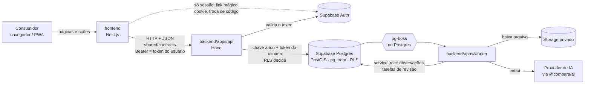
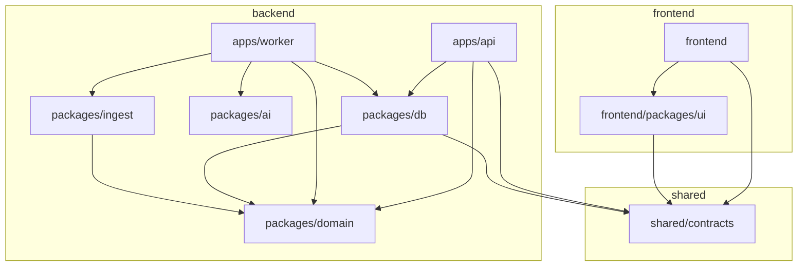

# Arquitetura

Monorepo único (pnpm + Turborepo) com **duas aplicações independentes** — `frontend/` e `backend/` — e uma pasta `shared/` que contém **só** o contrato entre elas. Cada lado tem dependências, scripts, testes, build e imagem/deploy próprios.

| Peça                  | Papel                                                                                                                                         | Deploy                 |
| --------------------- | --------------------------------------------------------------------------------------------------------------------------------------------- | ---------------------- |
| `frontend/`           | **Interface**: PWA em Next.js. Páginas, componentes, estado de tela, formatação, acessibilidade. Não tem regra de negócio nem acesso a dados. | Vercel                 |
| `backend/apps/api`    | **API HTTP v1** (Hono): leituras públicas, comparação de lista, autenticação/autorização e administração.                                     | Container (Dockerfile) |
| `backend/apps/worker` | **Processamento assíncrono**: fila, pipeline de ingestão, IA. Único que detém `service_role`.                                                 | Container (Dockerfile) |
| `backend/supabase`    | **Dados**: Postgres + RLS + RPCs (`compare_list`, `search_products`…) + Auth + Storage.                                                       | Supabase               |
| `shared/contracts`    | **Contrato** front ↔ API: rotas, schemas Zod e tipos. Versionado (`CONTRACT_VERSION`).                                                        | —                      |

A decisão e as alternativas estão no [ADR-0005](adr/0005-separacao-frontend-backend.md); ela substitui a parte do [ADR-0004](adr/0004-fronteiras-e-contratos.md) que adiava a API.

## Visão de sistema



O navegador **nunca** fala com a API nem com o banco: só com o servidor do Next, que repassa à API (o token fica em cookie `httpOnly`). A API **não usa `service_role`**: age com a identidade do usuário, então a RLS continua sendo a barreira final.

## Dependências entre pacotes

Setas = "pode importar". Qualquer outra direção, ou qualquer travessia entre `frontend` e `backend`, falha em `pnpm arch:check`.



| Pacote                 | Responsabilidade                                                               | Pode usar             | Não pode tocar                         |
| ---------------------- | ------------------------------------------------------------------------------ | --------------------- | -------------------------------------- |
| `shared/contracts`     | Rotas, schemas e tipos da API (versionado)                                     | `zod`                 | banco, `domain`, regras internas, Node |
| `backend/…/domain`     | Regras puras: preço unitário, frescor, GTIN, normalização, comparação de lista | —                     | framework, banco, rede, Node           |
| `backend/…/ingest`     | Casamento de produto, validação, decisão de publicação, golden set             | `domain`              | framework, banco, rede                 |
| `backend/…/ai`         | Provedor de IA, schemas de extração, prompts versionados, custo                | —                     | banco                                  |
| `backend/…/db`         | Consultas tipadas; **única** camada que conhece colunas e tabelas              | `contracts`, `domain` | React, Next                            |
| `frontend/packages/ui` | Componentes visuais, tokens e **formatação de apresentação** (preço, idade)    | `contracts`           | banco, servidor                        |

## Front-end (`frontend/src`) — por funcionalidade

```text
app/                  rotas finas: buscam dados via API e compõem features
features/
  catalog/            busca e histórico de preço         (components/)
  shopping-list/      lista, comparação entre mercados   (components/, list-store.ts, actions.ts)
  offers/             ofertas vigentes                   (components/)
  stores/             mapa e lista de mercados           (components/)
  auth/               login por link mágico              (components/, actions.ts)
  admin/              preço manual e fila de revisão     (components/, actions.ts)
shared/
  components/         casca do app: nav, tema, service worker
  lib/                formatação de apresentação, rate limit do login (puro, testável)
  api/                cliente tipado da API (client.ts, endpoints.ts) — só servidor
  server/             env, IP do cliente, sessão e cliente do Supabase Auth — só servidor
```

**O que sobrou de "servidor" no Next, e por quê.** São adaptadores finos, sem regra de negócio e sem acesso a dados:

| Arquivo                                         | O que faz                                                      | Por que continua no Next                                                            |
| ----------------------------------------------- | -------------------------------------------------------------- | ----------------------------------------------------------------------------------- |
| `features/auth/actions.ts`, `app/auth/callback` | Enviar link mágico, sair, trocar o código por sessão (cookie)  | O fluxo PKCE do Supabase exige o mesmo servidor que iniciou o link e grava o cookie |
| `shared/server/supabase/auth-client.ts`         | Cliente do Supabase Auth com **chave pública**, só para sessão | Idem; nenhuma consulta a tabelas passa por aqui (regra R6)                          |
| `shared/server/session.ts`                      | Lê o token do cookie e pergunta à API `GET /v1/me`             | O token só existe no servidor do Next (cookie `httpOnly`)                           |
| `features/shopping-list/actions.ts`             | Valida a lista, repassa o IP e chama a API                     | O navegador não conhece a URL da API                                                |
| `features/admin/actions.ts`                     | Valida o formulário (texto → centavos) e chama a API           | Idem; autorização e regra de validade de oferta são da API                          |

Regras (verificadas): uma feature **nunca** importa outra; `shared` não conhece `features` nem `app`; código de navegador (`"use client"` e `components/`) nunca importa `shared/api`, `shared/server` nem `next/headers`; `@supabase/*` só aparece em `shared/server/supabase/`.

## Back-end

### API (`backend/apps/api`)

```text
src/main.ts, env.ts, logger.ts   subida, ambiente validado (Zod), logs pino com redação
src/app.ts                       composição: middlewares, rotas, tratamento de erro padronizado
src/http/                        auth (Bearer), rate limit, cache de leitura, validação, erros
src/routes/                      catalog.ts (público) · account.ts (/me e /admin)  — sem persistência
src/services/                    portas (types.ts) + implementação Supabase + regra de frescor
```

- **Portas e adaptadores.** As rotas só conhecem as interfaces de `services/types.ts`; a implementação com Supabase fica em `supabase-services.ts`. Os testes das rotas usam serviços em memória (sem rede nem banco) e há testes de integração contra o Supabase local.
- **Autorização no back-end.** `requireUser` valida o token no Supabase e lê o papel em `profiles`; `requireAdmin` exige `admin`. As operações administrativas usam um cliente que **age como o usuário** (`createUserClient`), então a RLS decide de novo.
- **Frescor é regra de negócio do back-end.** A API devolve `ageDays` e `freshness` (`fresh`/`recent`/`stale`) calculados com `domain`; o front só exibe.
- **Cache.** Leituras públicas ficam 60 s em memória na API (mercados, 5 min), por instância. Substitui o ISR do tempo em que o front lia o banco.
- **Erros.** Formato único `{ "error": { "code", "message" } }`; falhas de banco viram `502 data_unavailable` e erros inesperados `500`, sem vazar detalhe.

### Worker (`backend/apps/worker`)

```text
pipeline/ports.ts            portas (PipelineRepo): o que o pipeline precisa do mundo
pipeline/run.ts              caso de uso runPipeline — só conhece as portas e os pacotes puros
pipeline/supabase-repo.ts    adaptador das portas sobre Supabase (infraestrutura)
jobs.ts · main.ts            filas pg-boss, /healthz e a ligação de tudo (composição)
```

### Dados (`backend/supabase`)

`GRANT` mínimo por papel → **RLS** por linha → **triggers** de invariantes (observação imutável, perfil não se auto-promove, teto diário, auditoria) → **testes pgTAP** no CI. Migrações em `backend/supabase/migrations`, nunca editadas depois de aplicadas (ver runbook).

## Fluxo de um preço

1. **Captura** — arquivo vai ao Storage com `sha256` único (não reprocessa duplicado) e vira `sources`.
2. **Extração** — IA devolve JSON validado (Zod); o bruto fica em `extractions`.
3. **Normalização** — unidades e preço por kg/litro/unidade (`backend/packages/domain`).
4. **Casamento** — GTIN → alias aprovado → trigramas com ajuste por tamanho (`backend/packages/ingest`).
5. **Validação** — validade vencida, duplicata, preço fora da mediana.
6. **Publicação** — confiança = mín(extração, casamento) ≥ limiar e sem alertas → `approved`; senão `pending` + `review_tasks`; bloqueios são descartados.
7. **Feedback** — correção humana vira alias/caso de teste.

O preço mostrado ao usuário vem **sempre** de `current_prices` (a observação aprovada e vigente mais recente por mercado × produto), servido pela API.

## Fronteiras verificadas (`pnpm arch:check`)

O script [`scripts/check-architecture.mjs`](../scripts/check-architecture.mjs) roda na CI e falha o PR se uma regra for quebrada. Foi testado injetando uma violação de cada tipo.

| Regra | O que garante                                                                                                                   |
| ----- | ------------------------------------------------------------------------------------------------------------------------------- |
| R1    | Sem ciclos de importação entre arquivos                                                                                         |
| R2    | Cada workspace só depende do que a tabela acima permite; sem import profundo (`@compara/x/src/…`)                               |
| R3    | **`frontend` e `backend` nunca se importam**; `shared` não importa nenhum dos dois                                              |
| R4    | `domain`, `ingest` e `contracts` não importam framework, banco, rede nem `node:*`                                               |
| R5    | Front: features isoladas entre si; `shared` e `features` não dependem de `app`                                                  |
| R6    | Front: código de navegador não importa código de servidor; `@supabase/*` só para sessão                                         |
| R7    | `service_role` só no worker; segredos do back-end (`SERVICE_ROLE`, `ANTHROPIC_API_KEY`, `DATABASE_URL`) nunca aparecem no front |
| R8    | API: `routes/` e `http/` não acessam persistência (só `services/`)                                                              |
| R9    | Worker: só `main`, `jobs` e `supabase-repo` tocam infraestrutura                                                                |

## Build, teste e deploy independentes

| Lado   | Desenvolver         | Compilar                              | Imagem / deploy                                    |
| ------ | ------------------- | ------------------------------------- | -------------------------------------------------- |
| Front  | `pnpm dev:frontend` | `pnpm build:frontend`                 | Vercel (precisa só de `API_URL` e chaves públicas) |
| API    | `pnpm dev:api`      | `pnpm --filter @compara/api build`    | `backend/apps/api/Dockerfile`                      |
| Worker | `pnpm dev:worker`   | `pnpm --filter @compara/worker build` | `backend/apps/worker/Dockerfile`                   |

O build do front **não precisa da API no ar** (as páginas renderizam sob demanda). Na CI, `frontend` e `backend` são jobs separados; só `e2e` e `database` sobem os dois lados juntos.

## Onde cada coisa mora

| Preciso de…                       | Vá em…                                                           |
| --------------------------------- | ---------------------------------------------------------------- |
| Tela, rota, ação de formulário    | `frontend/src/features/<feature>` (rota em `frontend/src/app`)   |
| Formatar preço, data, distância   | `frontend/packages/ui` / `frontend/src/shared/lib`               |
| Chamar a API                      | `frontend/src/shared/api/endpoints.ts`                           |
| Novo endpoint ou mudar um formato | `shared/contracts` + `backend/apps/api/src/routes` + `services/` |
| Regra de preço/lista/frescor      | `backend/packages/domain` (+ migração `…005…` para a versão SQL) |
| Casar/validar/decidir publicação  | `backend/packages/ingest`                                        |
| Falar com a IA, schemas, custo    | `backend/packages/ai`                                            |
| Consulta ao banco                 | `backend/packages/db` (e o serviço da API que a usa)             |
| Orquestração dos jobs             | `backend/apps/worker/src/pipeline`                               |
| Tabela, política RLS, função SQL  | `backend/supabase/migrations`                                    |
