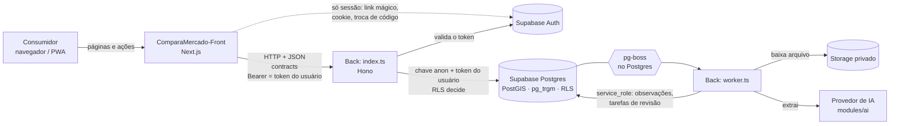

# Arquitetura

Monorepo único (pnpm + Turborepo) com **duas aplicações independentes** — `ComparaMercado-Front/` e `ComparaMercado-Back/` —, no mesmo padrão do ProAgendaV2. Cada uma tem dependências, scripts, testes, build e imagem/deploy próprios. O único elo entre elas é o **contrato HTTP** (schemas Zod e tipos puros) em `ComparaMercado-Back/src/contracts`, que o Front lê pelo alias `@contracts`.

| Peça                                | Papel                                                                                                                                         | Deploy                          |
| ----------------------------------- | --------------------------------------------------------------------------------------------------------------------------------------------- | ------------------------------- |
| `ComparaMercado-Front/`             | **Interface**: PWA em Next.js. Páginas, componentes, estado de tela, formatação, acessibilidade. Não tem regra de negócio nem acesso a dados. | Vercel                          |
| `ComparaMercado-Back` — API         | **API HTTP v1** (Hono, `src/index.ts`): leituras públicas, comparação de lista, autenticação/autorização e administração.                     | Container (`Dockerfile`)        |
| `ComparaMercado-Back` — worker      | **Processamento assíncrono** (`src/worker.ts`): fila, pipeline de ingestão, IA. Único que detém `service_role`.                               | Container (`Dockerfile.worker`) |
| `ComparaMercado-Back/supabase/`     | **Dados**: Postgres + RLS + RPCs (`compare_list`, `search_products`…) + Auth + Storage.                                                       | Supabase                        |
| `ComparaMercado-Back/src/contracts` | **Contrato** Front ↔ API: rotas, schemas Zod e tipos. Versionado (`CONTRACT_VERSION`).                                                        | —                               |

API e worker são dois pontos de entrada do **mesmo pacote** (`comparamercado-back`), que compartilham `lib/`, `modules/` e `database/` por imports relativos. A decisão e as alternativas estão nos ADRs [0005](adr/0005-separacao-frontend-backend.md) e [0007](adr/0007-layout-front-back-por-aplicacao.md).

## Visão de sistema



O navegador **nunca** fala com a API nem com o banco: só com o servidor do Next, que repassa à API (o token fica em cookie `httpOnly`). A API **não usa `service_role`**: age com a identidade do usuário, então a RLS continua sendo a barreira final.

## Front-end (`ComparaMercado-Front/src`)

Mesma organização do `ProAgendaV2-Front`, adaptada ao App Router do Next (`app/` faz o papel de `pages/` + `routes/`):

```text
app/                  rotas finas (páginas, layouts, route handlers): buscam dados e compõem módulos
modules/<x>/          uma pasta por funcionalidade, isoladas entre si
  components/           componentes da funcionalidade
  actions.ts            Server Actions da funcionalidade (quando há)
  (account · admin · auth · catalog · offers · shopping-list · stores)
components/
  ui/                 primitivos visuais sem regra de domínio (button, dialog, controls, primitives)
  layout/             casca do app (nav)
  shared/             compostos reutilizáveis (price, confirm-submit, sw-register)
lib/                  funções puras: format, search, rate-limit, client-ip, utils (cn) — testes em __tests__/
services/api/         cliente tipado da API (client.ts, endpoints.ts) — só servidor
stores/               estado de cliente persistido (shopping-list.store.ts)
server/               env, IP do cliente, sessão, cliente do Supabase Auth — só servidor
styles/               globals.css (entrada) e tokens.css (design tokens "Liquid Glass")
```

**O que sobrou de "servidor" no Next, e por quê.** São adaptadores finos, sem regra de negócio e sem acesso a dados:

| Arquivo                                        | O que faz                                                      | Por que continua no Next                                                            |
| ---------------------------------------------- | -------------------------------------------------------------- | ----------------------------------------------------------------------------------- |
| `modules/auth/actions.ts`, `app/auth/callback` | Enviar link mágico, sair, trocar o código por sessão (cookie)  | O fluxo PKCE do Supabase exige o mesmo servidor que iniciou o link e grava o cookie |
| `server/supabase/auth-client.ts`               | Cliente do Supabase Auth com **chave pública**, só para sessão | Idem; nenhuma consulta a tabelas passa por aqui (regra R6)                          |
| `server/session.ts`                            | Lê o token do cookie e pergunta à API `GET /v1/me`             | O token só existe no servidor do Next (cookie `httpOnly`)                           |
| `modules/shopping-list/actions.ts`             | Valida a lista, repassa o IP e chama a API                     | O navegador não conhece a URL da API                                                |
| `modules/admin/actions.ts`                     | Valida o formulário (texto → centavos) e chama a API           | Idem; autorização e regra de validade de oferta são da API                          |

Regras (verificadas): um módulo **nunca** importa outro (o que dois módulos usam sobe para `stores/`, `lib/` ou `components/`); `components/`, `lib/`, `services/`, `stores/` e `server/` não conhecem `modules/` nem `app/`; código de navegador (`"use client"` e `components/`) nunca importa `server/`, `services/api/` nem `next/headers`; `@supabase/*` só aparece em `server/supabase/`.

Convenções: alias `@/` para tudo dentro de `src/`; arquivos em `kebab-case`; o estado de servidor vem da API (Server Components) e `stores/` guarda só estado de cliente; `@contracts` é o único import que cruza para o Back.

## Back-end (`ComparaMercado-Back/src`)

```text
index.ts · worker.ts      pontos de entrada: API HTTP e worker
app.ts · services.ts      createApp (sem ambiente nem porta) · raiz de composição (createSupabaseServices)
config/                   ambiente validado com Zod (env.ts da API, worker-env.ts do worker)
contracts/                contrato HTTP (schemas Zod + tipos puros) — o Front lê daqui
lib/                      regras puras: dinheiro em centavos, preço unitário, GTIN, normalização, frescor
middlewares/              auth (Bearer), rate limit, cache de leitura, contexto, erros
database/                 cliente Supabase e tipos gerados (database.types.ts)
jobs/                     filas pg-boss e agendamentos
modules/<x>/              catalog · ingest · ai · auth · admin · pricing · promotions · stock
  controller/               rotas Hono, só HTTP
  service/                  regra de negócio / caso de uso
  repository/               única camada que conhece tabelas e colunas
  <x>.types.ts              portas do módulo (os testes montam serviços em memória)
```

- **Portas e adaptadores.** O controller só conhece as portas do módulo; a implementação com Supabase fica no `repository`. Os testes das rotas usam serviços em memória (sem rede nem banco) e há testes de integração contra o Supabase local.
- **Autorização no back-end.** `requireUser` valida o token no Supabase e lê o papel em `profiles`; `requireAdmin` exige `admin`. As operações administrativas usam um cliente que **age como o usuário** (`createUserClient`), então a RLS decide de novo.
- **Frescor é regra de negócio do Back.** A API devolve `ageDays` e `freshness` (`fresh`/`recent`/`stale`); o Front só exibe.
- **Cache.** Leituras públicas ficam 60 s em memória na API (mercados, 5 min), por instância.
- **Erros.** Formato único `{ "error": { "code", "message" } }`; falhas de banco viram `502 data_unavailable` e erros inesperados `500`, sem vazar detalhe.
- **Pipeline de ingestão.** `modules/ingest/service/pipeline.service.ts` é o caso de uso e só conhece as portas de `pipeline.types.ts`; a infraestrutura fica em `repository/pipeline.repository.ts`, `jobs/` e `worker.ts`.

### Dados (`ComparaMercado-Back/supabase`)

`GRANT` mínimo por papel → **RLS** por linha → **triggers** de invariantes (observação imutável, perfil não se auto-promove, teto diário, auditoria) → **testes pgTAP** no CI. Migrações em `ComparaMercado-Back/supabase/migrations`, nunca editadas depois de aplicadas (ver runbook).

## Fluxo de um preço

1. **Captura** — arquivo vai ao Storage com `sha256` único (não reprocessa duplicado) e vira `sources`.
2. **Extração** — IA devolve JSON validado (Zod); o bruto fica em `extractions`.
3. **Normalização** — unidades e preço por kg/litro/unidade (`ComparaMercado-Back/src/lib`).
4. **Casamento** — GTIN → alias aprovado → trigramas com ajuste por tamanho (`ComparaMercado-Back/src/modules/ingest/service`).
5. **Validação** — validade vencida, duplicata, preço fora da mediana.
6. **Publicação** — confiança = mín(extração, casamento) ≥ limiar e sem alertas → `approved`; senão `pending` + `review_tasks`; bloqueios são descartados.
7. **Feedback** — correção humana vira alias/caso de teste.

O preço mostrado ao usuário vem **sempre** de `current_prices` (a observação aprovada e vigente mais recente por mercado × produto), servido pela API.

## Fronteiras verificadas (`pnpm arch:check`)

O script [`scripts/check-architecture.mjs`](../scripts/check-architecture.mjs) roda na CI e falha o PR se uma regra for quebrada. As regras são exercitadas injetando uma violação de cada tipo.

| Regra | O que garante                                                                                                                                          |
| ----- | ------------------------------------------------------------------------------------------------------------------------------------------------------ |
| R1    | Sem ciclos de importação entre arquivos                                                                                                                |
| R2    | Nenhum pacote `@compara/*`: cada aplicação é autocontida                                                                                               |
| R3    | **Front e Back nunca se importam por caminho**; a única ponte é o alias `@contracts`                                                                   |
| R4    | Arquivos de regra pura (`lib/`, `contracts/`, `catalog/service/compare.ts`, `ingest/service/*` puros) não importam framework, banco, rede nem `node:*` |
| R5    | Front: módulos isolados entre si; `components/`, `lib/`, `services/`, `stores/`, `server/` não dependem de `modules/` nem `app/`                       |
| R6    | Front: código de navegador não importa código de servidor; `@supabase/*` só em `server/supabase/`                                                      |
| R7    | `service_role` só no worker, jobs, database e testes; segredos do Back (`SERVICE_ROLE`, `ANTHROPIC_API_KEY`, `DATABASE_URL`) nunca no Front            |
| R8    | Back: controller, middlewares e `app.ts` não acessam persistência (só o service fala com o repository)                                                 |
| R9    | Back: repository/service não dependem de controller; `pipeline.service.ts` não conhece infraestrutura                                                  |

## Build, teste e deploy independentes

| Aplicação | Desenvolver (um terminal cada) | Compilar                                         | Imagem / deploy                                    |
| --------- | ------------------------------ | ------------------------------------------------ | -------------------------------------------------- |
| Front     | `pnpm dev:front`               | `pnpm build:front`                               | Vercel (precisa só de `API_URL` e chaves públicas) |
| API       | `pnpm dev:back`                | `pnpm --filter comparamercado-back build:api`    | `ComparaMercado-Back/Dockerfile`                   |
| Worker    | `pnpm dev:worker`              | `pnpm --filter comparamercado-back build:worker` | `ComparaMercado-Back/Dockerfile.worker`            |

O build do Front **não precisa da API no ar** (as páginas renderizam sob demanda). Na CI, `frontend` e `backend` são jobs separados; só `e2e` e `database` sobem os dois lados juntos. Como iniciar cada um em seu terminal: [runbook de desenvolvimento local](runbooks/desenvolvimento-local.md).

## Onde cada coisa mora

| Preciso de…                           | Vá em…                                                                                           |
| ------------------------------------- | ------------------------------------------------------------------------------------------------ |
| Tela, rota, ação de formulário        | `ComparaMercado-Front/src/modules/<x>` (rota em `src/app`)                                       |
| Componente visual genérico / da casca | `ComparaMercado-Front/src/components/{ui,layout,shared}`                                         |
| Formatar preço, data, distância       | `ComparaMercado-Front/src/lib/format.ts`                                                         |
| Chamar a API                          | `ComparaMercado-Front/src/services/api/endpoints.ts`                                             |
| Novo endpoint ou mudar um formato     | `ComparaMercado-Back/src/contracts` + `modules/<x>/controller` + `service` + `repository`        |
| Regra de preço/lista/frescor          | `ComparaMercado-Back/src/lib` e `modules/catalog/service` (+ migração `…005…` para a versão SQL) |
| Casar/validar/decidir publicação      | `ComparaMercado-Back/src/modules/ingest/service`                                                 |
| Falar com a IA, schemas, custo        | `ComparaMercado-Back/src/modules/ai/service`                                                     |
| Consulta ao banco                     | `ComparaMercado-Back/src/modules/<x>/repository` ([ADR-0006](adr/0006-persistencia-e-orm.md))    |
| Entender o modelo de dados            | [`docs/database`](database/README.md)                                                            |
| Orquestração dos jobs                 | `ComparaMercado-Back/src/jobs` e `modules/ingest/service/pipeline.service.ts`                    |
| Tabela, política RLS, função SQL      | `ComparaMercado-Back/supabase/migrations`                                                        |
