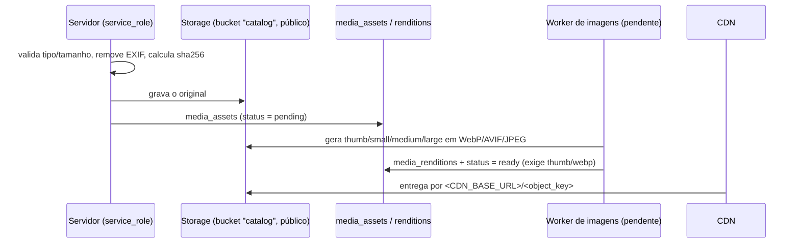

# Imagens e mídias

**Regra:** o banco guarda **metadados e referências**; os arquivos ficam no Storage de objetos com CDN na frente. Nenhum binário em tabela relacional.

## Fluxo

- A **URL não é guardada**: a API monta `<CDN_BASE_URL>/<object_key>`. Trocar de CDN/bucket não exige migração.
- `sha256` é único: a mesma imagem não é registrada duas vezes.
- Tipos aceitos: JPEG, PNG, WebP, AVIF (no banco e no bucket); 10 MB no bucket `catalog`.
- Bucket `catalog` é público para leitura via CDN; **escrita só pelo servidor** (nenhuma política de cliente).

## Tabelas

| Tabela                                           | Papel                                                                                                                                                     |
| ------------------------------------------------ | --------------------------------------------------------------------------------------------------------------------------------------------------------- |
| `media_assets`                                   | Original: chave do objeto, MIME, bytes, dimensões, `alt_text`, `status` (`pending/processing/ready/failed`)                                               |
| `media_renditions`                               | Derivados por `variant` (thumb 160, small 320, medium 800, large 1600 — valores de referência) × `format`. Apaga junto com o asset (derivado descartável) |
| `product_media`, `brand_media`, `category_media` | Vínculo com `position` e `is_primary` (no máximo uma principal por dono)                                                                                  |
| `product_thumbnails` (view)                      | Uma linha por produto com a miniatura WebP da imagem principal **pronta**                                                                                 |

Três tabelas de vínculo (e não uma polimórfica `entity_type/entity_id`) para manter **chave estrangeira real**: referência quebrada é impossível.

## O que as listagens leem

`listProductsPage` faz um único `LEFT JOIN` em `product_thumbnails`: devolve **chave, largura, altura e alt da miniatura** — nunca o original, nenhuma imagem extra por produto (sem N+1). Para a página de detalhe, a galeria completa sai de `product_media` ordenada por `position`, e a rendition certa é escolhida pelo dispositivo (consulta ainda não implementada; o modelo a suporta).

## Integridade

- Um asset **só vira `ready`** se tiver a rendition `thumb/webp` (`23514`); não nasce pronto.
- Asset **em uso** não volta para `pending/processing/failed`; asset **nunca é apagado** fisicamente (`42501`).
- Público só enxerga assets `ready` (e vínculos cujo asset é visível); o admin vê falhas.

## Entrega e desempenho (recomendações; ainda não implementadas)

| Tema           | Recomendação                                                                                                             |
| -------------- | ------------------------------------------------------------------------------------------------------------------------ |
| Formatos       | AVIF com fallback WebP, JPEG como último recurso (`<picture>` ou `Accept` negociado no CDN)                              |
| Responsividade | `srcset`/`sizes` apontando para as renditions; `loading="lazy"` abaixo da dobra; `width`/`height` evitam salto de layout |
| Cache HTTP     | Chave contém o conteúdo (hash/id da rendition) ⇒ `Cache-Control: public, max-age=31536000, immutable`                    |
| Processamento  | Worker com `sharp` consumindo `media_assets_pending_idx`; idempotente por (asset, variante, formato)                     |

**Pendências:** o worker de renditions, o endpoint de upload e a configuração do CDN não existem ainda; o seed usa chaves `demo/…` sem arquivos reais. O modelo e as garantias estão prontos e testados.
