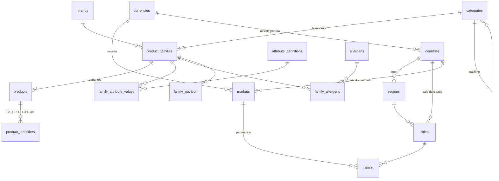
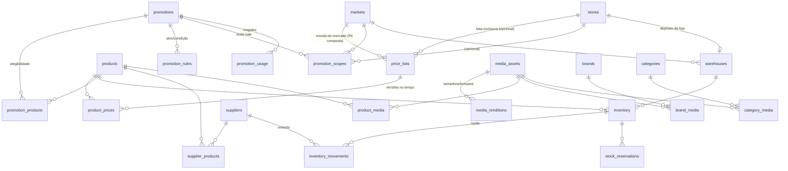

# Modelo de dados

> Fonte da verdade: `ComparaMercado-Back/supabase/migrations`. Este documento explica a intenção; se divergir do SQL, o SQL vence (e este arquivo deve ser corrigido).

## Diagrama ER

### Geografia, mercados e catálogo

### Preços, promoções, estoque e mídia

(O comparador — `price_observations`, `sources`, `product_aliases`, `review_tasks`, `shopping_lists`… — está descrito em [architecture.md](../architecture.md) e não mudou.)

## Tabelas e responsabilidades

### Geografia e mercados — `0009`

| Tabela       | Responsabilidade                                                                                                   | Chave            |
| ------------ | ------------------------------------------------------------------------------------------------------------------ | ---------------- |
| `currencies` | Moedas ISO 4217 e `minor_unit` (casas decimais: BRL 2, JPY 0). Subconjunto curado; ampliar por migração.           | `code` (natural) |
| `countries`  | Países ISO 3166-1 alfa-2 e moeda padrão. `active` marca onde operamos.                                             | `code` (natural) |
| `regions`    | Subdivisões ISO 3166-2 (27 UFs carregadas). Hierárquica (`parent_id`).                                             | `uuid`           |
| `markets`    | Escopo comercial: país (+região), **moeda (imutável)**, fuso IANA, locale, convenção fiscal. Um nacional por país. | `uuid`           |
| `cities`     | **Alterada**: `country_code`, `region_id`; `ibge_code`/`uf` agora opcionais (obrigatórios só no Brasil).           | `uuid`           |
| `stores`     | **Alterada**: `market_id` obrigatório (preenchido por gatilho a partir do país da cidade se omitido).              | `uuid`           |

Chaves naturais ISO (`code`) nas tabelas de referência: são padrões estáveis e legíveis em qualquer consulta/log; UUID seria indireção sem ganho. Nas demais tabelas, UUID (gerado no banco).

### Catálogo — `0010`

| Tabela                                             | Responsabilidade                                                                                                                                                 |
| -------------------------------------------------- | ---------------------------------------------------------------------------------------------------------------------------------------------------------------- |
| `brands`                                           | Marca normalizada (`slug` único). `manufacturer` é texto até precisar de atributos próprios.                                                                     |
| `product_families`                                 | **Identidade**: nome, marca, categoria, descrição, ingredientes. Fonte de marca/categoria das variantes.                                                         |
| `products`                                         | **Variante** (alterada): GTIN, tamanho, `sale_mode` (unidade/peso/volume), `pack_quantity`, rótulo, peso bruto, dimensões. `family_id` obrigatório.              |
| `product_identifiers`                              | Identificadores adicionais: `sku`, `internal_code`, `plu` (por mercado), `gtin_alt` (embalagem antiga), `mpn`. O GTIN **principal** continua em `products.gtin`. |
| `attribute_definitions`, `family_attribute_values` | Atributos flexíveis **tipados** (texto/número/booleano), sem JSON. Valor compatível com o tipo, por gatilho.                                                     |
| `allergens`, `family_allergens`                    | 14 alérgenos de declaração obrigatória; presença `contains` / `may_contain`.                                                                                     |
| `family_nutrition`                                 | 1:1 com a família; colunas tipadas por 100 g / 100 ml; CHECKs (açúcares ≤ carboidratos, saturadas ≤ gordura).                                                    |

**Por que `products` não foi renomeada para `product_variants`.** O enunciado separa identidade (`products`) de variante (`product_variants`). Aqui `products` _já era_ a variante (GTIN + tamanho), e views (`price_board`, `current_prices`), RPCs (`search_products`, `compare_list`), RLS, API, tipos e testes dependem dela. Renomear seria uma migração destrutiva e arriscada sem ganho funcional; a **identidade** foi adicionada como `product_families`. A divergência de nome está documentada aqui e no glossário do README.

**Marca/categoria são da família.** `products.brand`, `products.brand_id` e `products.category_id` ficam como cópia de leitura (busca trigram, `price_board` e a API dependem delas), mantida por gatilho: criar produto "do jeito antigo" (sem `family_id`) cria/reaproveita a família; alterar só o produto é erro `23514`; renomear a marca ou mover a família propaga para todas as variantes.

**Não criados (e por quê):** `product_categories` (N:M) — uma taxonomia canônica por família basta; coleções de merchandising entram quando houver o requisito. `product_units` — coberto por `size_*`/`base_unit` (colunas geradas) + `sale_mode` + `pack_quantity`. Traduções (`*_translations`) — nomes estão em um idioma por catálogo; é aditivo quando o 2º idioma chegar (a estrutura não impede).

### Preços — `0011`, `0015`

| Tabela           | Responsabilidade                                                                                            |
| ---------------- | ----------------------------------------------------------------------------------------------------------- |
| `price_lists`    | Lista de um mercado (ou de uma loja). FK composta garante **moeda = a do mercado** e **loja ∈ mercado**.    |
| `product_prices` | Versões de preço `[valid_from, valid_to)`; **exclusão GiST** impede sobreposição; imutável (só se encerra). |

`price_history` não existe como tabela separada: `product_prices` **é** o histórico. Detalhes em [precos-e-moedas.md](precos-e-moedas.md).

### Promoções — `0012`

| Tabela               | Responsabilidade                                                                                       |
| -------------------- | ------------------------------------------------------------------------------------------------------ |
| `promotions`         | Definição, vigência, ciclo de vida, empilhamento, limites. Nasce rascunho; sai do rascunho = imutável. |
| `promotion_products` | Variantes elegíveis (e quantidade do componente em combos).                                            |
| `promotion_rules`    | Alvo por categoria/marca (inclui subcategorias) e condições (`min_quantity`, `min_spend`).             |
| `promotion_scopes`   | Onde vale: mercado, e opcionalmente uma loja (FK composta loja ∈ mercado).                             |
| `promotion_usage`    | Resgates, somente inclusão, idempotente por `(promoção, pedido)`.                                      |

Ver [promocoes.md](promocoes.md).

### Estoque e fornecedores — `0013`

| Tabela                           | Responsabilidade                                                                                |
| -------------------------------- | ----------------------------------------------------------------------------------------------- |
| `warehouses`                     | Local com saldo: centro de distribuição **ou** retaguarda de uma loja (evita FK polimórfica).   |
| `inventory`                      | Saldo por (depósito, variante): físico, reservado, disponível (gerado), mínimo/máximo.          |
| `inventory_movements`            | **Razão** imutável: entrada, venda, devolução, ajuste, transferência (2 pernas), perda, avaria. |
| `stock_reservations`             | Reservas com validade; ativas/confirmadas/liberadas/expiradas.                                  |
| `suppliers`, `supplier_products` | Fornecedor e custo/prazo por produto; no máximo um preferencial.                                |

Ver [estoque.md](estoque.md).

### Mídias — `0014`

`media_assets` (metadados do original), `media_renditions` (thumb/small/medium/large × webp/avif/jpeg), `product_media`, `brand_media`, `category_media` (vínculos com ordem e imagem principal), view `product_thumbnails`. Ver [midias.md](midias.md).

### Operação — `0015`

`job_runs`: registro de execução dos jobs (início, fim, afetados, erro; chave de idempotência).

## Regras de integridade (resumo)

- **Dinheiro**: inteiro em unidade menor (`bigint`), nunca ponto flutuante; moeda vem da lista de preço, travada ao mercado por FK composta.
- **Datas**: `timestamptz` (UTC). Vigência é `[início, fim)`. Fuso/calendário local só na apresentação (`market_local_to_utc`).
- **Exclusão restrita**: FKs sem `ON DELETE CASCADE`, exceto `media_renditions` (derivado descartável). Entidades com histórico (produto, família, marca, preço, lista, promoção, fornecedor, depósito, saldo, reserva, asset) não aceitam `DELETE` por ninguém — usa-se `status`.
- **Histórico imutável**: `product_prices` (só encerra), `promotion_usage`, `inventory_movements` (somente inclusão), `promotions` (regras congeladas ao sair do rascunho; filhos só mudam em rascunho).
- **Estado válido**: transições de promoção por máquina de estados; reserva só confirma se ativa e dentro da validade; asset só `ready` com miniatura.
- **Auditoria**: `audit_changes` em markets, brands, famílias, identificadores, listas de preço, promoções, fornecedores e depósitos (além do que já existia).

## Índices (cada um com o motivo)

Além das PKs e `UNIQUE` (que implicam índice). **Removidos por falta de justificativa** na `0017`: `inventory_below_min_idx`, `promotions_expiry_idx`, `inventory_movements_transfer_idx`.

| Índice                                                    | Tabela                         | Consulta/escrita que o exige                                                                             |
| --------------------------------------------------------- | ------------------------------ | -------------------------------------------------------------------------------------------------------- |
| `product_prices_no_overlap` (GiST)                        | `product_prices`               | Garante a ausência de sobreposição **e** atende "preço de X na lista Y no instante T" (medido: ~0,05 ms) |
| `products_listing_idx` (parcial)                          | `products`                     | Paginação por cursor `ORDER BY canonical_name, id WHERE status='active'` (medido 48,5→0,44 ms)           |
| `products_family_idx`                                     | `products`                     | Variantes de uma família                                                                                 |
| `product_families_brand_idx` / `_category_idx` (parciais) | `product_families`             | Navegação por marca/categoria (somente ativas)                                                           |
| `product_identifiers_product_idx`                         | `product_identifiers`          | Identificadores de um produto                                                                            |
| `price_lists_scope_idx` (parcial)                         | `price_lists`                  | Listas ativas do mercado/loja na resolução de preço                                                      |
| `promotions_active_idx` (parcial)                         | `promotions`                   | O conjunto "ativas" é pequeno diante do histórico; é o que `resolve_prices` varre                        |
| `promotion_products_product_idx`                          | `promotion_products`           | "Quais promoções afetam este produto?" e detecção de conflitos                                           |
| `promotion_rules_promotion_idx`                           | `promotion_rules`              | Regras da promoção na resolução                                                                          |
| `promotion_usage_customer_idx` (parcial)                  | `promotion_usage`              | Contagem de usos por cliente (limite por cliente)                                                        |
| `inventory_product_idx`                                   | `inventory`                    | "Onde há estoque deste produto?" (a PK atende o sentido depósito→produto)                                |
| `inventory_movements_card_idx`                            | `inventory_movements`          | Cartão de estoque: extrato de um item em um depósito, mais recente primeiro                              |
| `stock_reservations_active_uq` (parcial único)            | `stock_reservations`           | Idempotência: uma reserva ativa por (item, referência)                                                   |
| `stock_reservations_expiry_idx` (parcial)                 | `stock_reservations`           | Varredura do job de expiração                                                                            |
| `media_assets_pending_idx` (parcial)                      | `media_assets`                 | Fila do worker de processamento de imagens                                                               |
| `*_media_asset_idx`                                       | `product/brand/category_media` | "Onde esta imagem é usada?" (guarda de asset em uso)                                                     |
| `*_primary_uq` (parcial único)                            | `*_media`                      | No máximo uma imagem principal por dono                                                                  |
| `markets_country_default_uq` (parcial único)              | `markets`                      | Um mercado nacional por país (resolve o padrão da loja)                                                  |
| `stores_market_idx` (parcial)                             | `stores`                       | Lojas ativas de um mercado                                                                               |
| `warehouses_store_uq`, `supplier_products_preferred_uq`   | —                              | Um depósito por loja; um fornecedor preferencial por produto                                             |
| `job_runs_job_idx`                                        | `job_runs`                     | Últimas execuções de um job; detecção de job parado                                                      |

Índices **não** criados de propósito: filtro por atributo (`family_attribute_values`) — nenhuma tela filtra ainda; `product_prices(product_id)` — o GiST cobre o acesso quente e preço por produto entre listas só aparece no admin.
